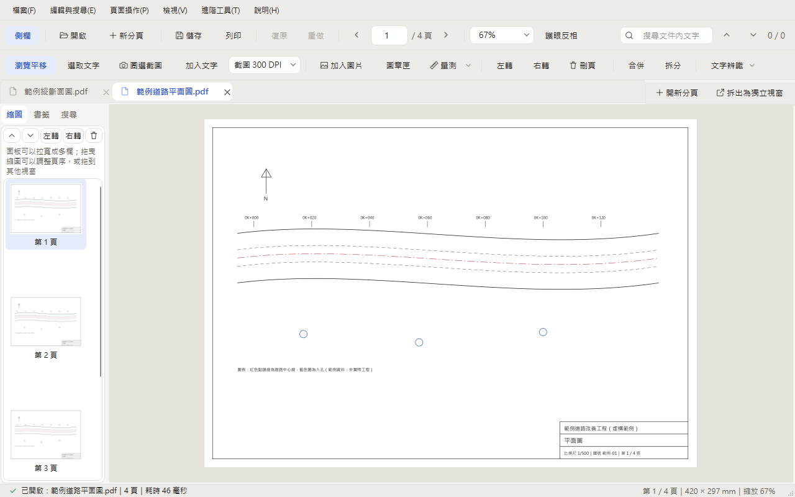
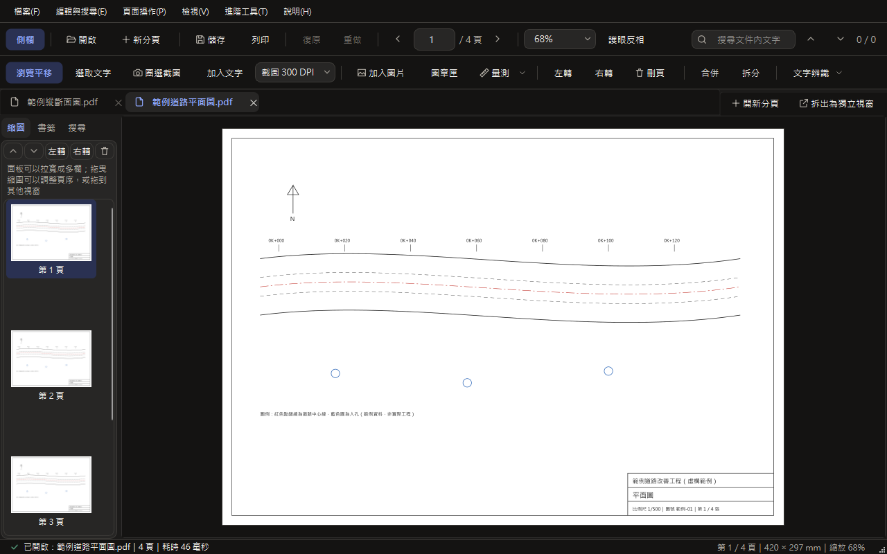

<div align="center">


# WingLightPDF — 輕快免安裝PDF檢視與編輯工具

**看圖紙、抽換頁面、蓋章、截一張清楚的圖，在一個免安裝、完全離線的小工具裡做完**

[](LICENSE)
[](#)
[](#)
[](../../actions)

</div>



<details>
<summary>深色主題的畫面</summary>



</details>

<sub>畫面中的 PDF 是程式產生的虛構範例（`tools/make_screenshots.py`），不是真實案件。</sub>

## 為什麼做這個

只是想看一張圖紙、抽換兩頁、蓋個章，或截一張貼進簡報也清楚的圖，商業 PDF 軟體又大又慢；線上工具則要把公文、地籍圖和工程圖紙上傳到別人的伺服器。

WingLightPDF 是道路工程師為自己每天的工作做的：解壓縮就能用，所有處理都在自己的電腦上完成，不連網、不上傳。

## 功能

| 功能 | 說明 |
| :--- | :--- |
| ⚡ 開得快 | 從點兩下到主視窗出現約 0.8 秒；已經開著時，從檔案總管再開 PDF 約 0.1 秒就加到分頁裡，重複的檔案直接切到原分頁 |
| 🗂️ 多份 PDF 分頁 | 同一個視窗開好幾份 PDF（Ctrl+T 新分頁、Ctrl+W 關閉）；分頁往外拖可以拆成兩個視窗，拖進別的視窗可以合併，未儲存的修改和復原紀錄都會跟著走 |
| 📄 縮圖與頁面 | 左側縮圖可以拉窄成單欄或拉寬成多欄；多頁拖曳排序、跨視窗拖頁、從檔案總管拖入 PDF 插入；旋轉、刪除、擷取、插入、合併、拆分、批次頁碼與浮水印 |
| ✂️ 高解析度截圖 | 圈選區域後從 PDF 重新以 300～600 DPI 畫出，貼進 Word、簡報不會糊；可以去背成透明 PNG，或去背並加深線條 |
| 💮 文字、圖片與圖章 | 加入繁體中文文字（字型內嵌，換電腦開也不會變亂碼）、圖片；內建核准、已審閱、機密、今日日期章，匯入簽名照片會自動去掉白底 |
| 📐 比例尺量測 | 在圖上已知長度的線段點兩下完成校正，就能量距離和多邊形面積（平方公尺與坪） |
| 🔍 雙檔比對 | 左右並排同步捲動縮放，或紅藍疊圖找出新舊版哪裡改了 |
| 🧠 文字辨識（OCR） | 平常 Ctrl+F 只搜尋 PDF 內的文字，不會在背景偷跑辨識；遇到掃描檔再手動辨識圈選區域、目前頁或整份文件，辨識結果可以寫進 PDF，下次直接搜尋 |
| 🌗 淺色、深色主題 | 第一次開啟跟著 Windows 的設定，可以在「檢視」選單切換；「護眼反相」把頁面換成黑底白線，看 CAD 圖紙比較不刺眼 |

## 下載與使用

1. 到右側 **[Releases](../../releases)** 下載其中一個版本。兩個版本功能相同，只差文字辨識的引擎：

   | 版本 | 下載大小 | 解壓縮後 | 文字辨識 | 適合 |
   |---|---|---|---|---|
   | `WingLightPDF-版本-Full.zip`（完整版） | 約 135 MB | 約 298 MB | RapidOCR PP-OCRv6 | 常要辨識掃描的數字表格、工程規範 |
   | `WingLightPDF-版本-Lite.zip`（輕量版） | 約 62 MB | 約 142 MB | Windows 內建 OCR | 一般公文與內文；密集的數字表格容易漏字 |

2. 解壓縮到任意位置，雙擊資料夾裡的 **`WingLightPDF.exe`**。不需要安裝，也不需要系統管理員權限。
3. 第一次執行時，Windows 可能出現「Windows 已保護您的電腦」：這是因為程式沒有付費的數位簽章，並不是病毒。請按「**其他資訊**」→「**仍要執行**」。執行檔是 GitHub Actions 從公開原始碼自動打包的，打包紀錄都在 [Actions](../../actions) 頁面。
4. 要設成電腦預設的 PDF 程式：在「檔案」選單按「設為 Windows 預設 PDF 開啟程式」，再照視窗說明在 Windows 裡確認。

設定（目前只有深淺色主題）存在程式旁邊的 `WingLightPDF.json`，整個資料夾搬到別台電腦設定也會跟著走。

輕量版的文字辨識需要 Windows 已安裝「中文(台灣)」的光學字元辨識語言：繁體中文 Windows 通常已內建，沒有的話到「設定 > 時間與語言 > 語言與地區 > 中文(台灣) > 語言選項」安裝。

## 從原始碼執行

```bash
git clone https://github.com/Human-chang/WingLightPDF.git
cd WingLightPDF
pip install -r requirements.txt
python main.py                                 # 啟動
python -m unittest discover -s tests -t .      # 單元測試
python main.py --self-test 結果.json            # 自我測試（不顯示視窗）
```

打包綠色免安裝版：執行 `打包綠色免安裝版.bat`（加 `full` 或 `lite` 只打包一版，加 `--no-pause` 跑完不停下來）。它會建立專用的 `.venv`、跑單元測試、依 `WingLightPDF_Core.spec` 用資料夾模式打包，再對成品跑一次自我測試，沒通過就不組裝。

- `tools/make_brand_assets.py`：從設計規範的 SVG 產生 App 圖示與啟動畫面的螢火蟲
- `tools/make_screenshots.py`：產生上面的介面截圖

---

## English

**WingLightPDF** is a portable, fully offline PDF viewer and light editor for Windows, built by a road engineer for daily work with drawings and official documents. Nothing is uploaded; everything runs on your own PC.

- Tabs for multiple PDFs; drag a tab out to split windows or into another window to merge. Opening a PDF from Explorer while it is running adds a tab in about 0.1 s.
- Thumbnails that reflow from one column to a grid; drag pages within or across windows; rotate, delete, extract, insert, merge, split, page numbers and watermarks
- 300–600 DPI region capture with transparent background and line darkening
- Text, images, stamps and signatures (white background removed automatically)
- Two-point scale calibration, distance and area measurement (m² and ping)
- Side-by-side and red/blue overlay comparison of two PDFs
- On-demand offline OCR (never runs in the background); results can be embedded as a searchable text layer
- Light and dark themes following Windows, plus an eye-care invert mode for drawings

Download a zip from **[Releases](../../releases)** (Full: bundled PP-OCRv6 OCR; Lite: Windows OCR), extract it anywhere and run `WingLightPDF.exe`. Windows SmartScreen may warn on first run because the app is not code-signed: choose *More info* → *Run anyway*. Release builds are produced by GitHub Actions from this source.

## License

[MIT](LICENSE) © 2026 [Human-chang](https://github.com/Human-chang)
